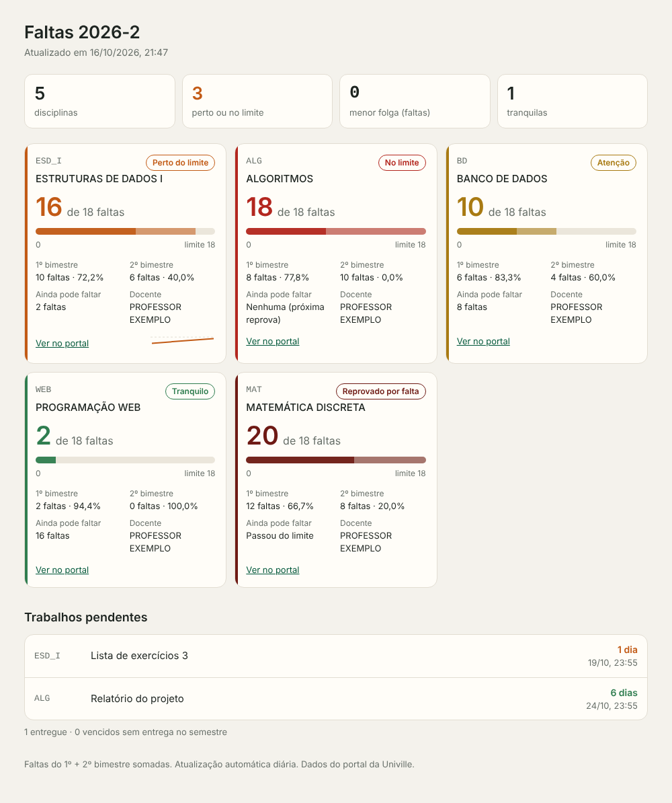

# Monitor de faltas da Univille

Verifica todo dia as suas faltas em cada disciplina no portal da Univille, soma 1º + 2º bimestre, avisa por e-mail quando você chega perto do limite e mantém um painel web sempre atualizado.

Funciona sozinho no GitHub Actions (computador desligado), de graça. Quando o semestre muda, ele pega as disciplinas novas automaticamente, sem você mexer em nada.



## O que ele faz

- Entra no portal com a sua matrícula e senha
- Lista as disciplinas do semestre atual na home (Meu Espaço)
- Em cada disciplina abre o Diário de Classe, passa por todos os professores e lê o "Controle de Frequência / Conteúdo"
- Soma as faltas do 1º e do 2º bimestre (se tiver mais de um professor, considera o maior total)
- Manda e-mail quando uma disciplina atinge 10, 12, 14, 16 ou 18 faltas (configurável). Um e-mail por nível, sem repetir
- Publica um painel no GitHub Pages com os dados **criptografados** (só abre com a sua senha)

O limite padrão é 18 faltas: passou disso, reprova.

## Como usar (passo a passo)

Você vai precisar de uma conta no GitHub e de um Gmail. Leva uns 10 minutos.

### 1. Crie a sua cópia do repositório

Clique em **Use this template → Create a new repository** (ou faça um fork). Deixe o repositório **público**, porque o GitHub Pages gratuito só funciona em repositório público. Seus dados não ficam expostos: as faltas vão criptografadas e os logs não mostram nada pessoal.

### 2. Gere uma senha de app no Gmail

O script manda e-mail pelo próprio Gmail. Por segurança o Google exige uma "senha de app" (não é a sua senha normal):

1. Ative a verificação em duas etapas na sua conta Google, se ainda não tiver
2. Acesse <https://myaccount.google.com/apppasswords>
3. Crie uma senha com o nome "monitor faltas" e copie os 16 caracteres

### 3. Cadastre os secrets

No seu repositório: **Settings → Secrets and variables → Actions → New repository secret**. Crie:

| Secret | O que colocar |
|---|---|
| `UNIVILLE_USUARIO` | Sua matrícula (o mesmo usuário do portal) |
| `UNIVILLE_SENHA` | Sua senha do portal |
| `SENHA_PAINEL` | Uma senha qualquer que você inventa, pra abrir o painel |
| `GMAIL_USUARIO` | Seu Gmail (ex: `voce@gmail.com`) |
| `GMAIL_SENHA_APP` | A senha de app do passo 2 |
| `EMAIL_DESTINO` | Opcional. Para onde mandar os alertas (padrão: o próprio Gmail) |

Os secrets ficam guardados criptografados pelo GitHub e ninguém consegue ver, nem você depois de salvar.

### 4. Ative o GitHub Pages

**Settings → Pages → Build and deployment → Source: GitHub Actions**.

### 5. Rode pela primeira vez

**Actions → Monitor de faltas → Run workflow**. Se for um fork, o GitHub pede pra você habilitar os workflows antes (botão verde na aba Actions).

Em uns 2 minutos você recebe um e-mail "Monitor ativado" com a situação de todas as disciplinas, e o painel fica em:

```
https://SEU_USUARIO.github.io/NOME_DO_REPOSITORIO/
```

Depois disso ele roda sozinho. O GitHub dispara de hora em hora, mas só a primeira verificação bem-sucedida de cada dia faz o trabalho; as outras terminam em segundos. Disparar manualmente pela aba Actions sempre verifica de novo.

## Configurações opcionais

Em **Settings → Secrets and variables → Actions → Variables** você pode criar:

| Variável | Padrão | Para que serve |
|---|---|---|
| `LIMITE_FALTAS` | `18` | Limite de faltas para reprovar |
| `NIVEIS_ALERTA` | `10,12,14,16,18` | Em quais totais mandar e-mail |
| `LIMITES_ESPECIFICOS` | vazio | Limite diferente por sigla, ex: `FDIA=20,EIXO-III=20` |
| `SEMESTRE` | o mais recente | Forçar um semestre, ex: `2026-2` |
| `URL_PAINEL` | GitHub Pages do repo | Se usar outro endereço pro painel |
| `HEADLESS` | `1` | `0` abre o navegador visível (precisa de runner na sua sessão, veja abaixo) |
| `ESPERA_CAPTCHA` | `240` com navegador visível | Segundos que o script espera você resolver o desafio de imagens |

Para mudar a frequência, edite a linha `cron` em `.github/workflows/monitor.yml` (o horário é em UTC, 3 horas a mais que Brasília).

## Se o login esbarrar no reCAPTCHA (rodar no seu computador)

O portal tem reCAPTCHA invisível do Google. Com navegador automático e invisível (como nos servidores do GitHub) ele costuma pedir o desafio de imagens, e o login falha. O script **não tenta burlar o captcha**. A saída é rodar no seu computador com o navegador **visível**: na maioria das vezes passa direto, e quando o Google pedir as imagens você mesmo resolve na janela (o script espera até 4 minutos e faz o resto sozinho).

Para isso o GitHub manda o trabalho pro seu computador através de um *runner* (programa oficial do GitHub). Agendamento, secrets, e-mail e painel continuam iguais.

1. No repositório: **Settings → Actions → Runners → New self-hosted runner**, escolha o seu sistema
2. Siga os comandos de *Download* e *Configure* que o GitHub mostra (no Windows, use o **PowerShell**, ou troque o download por `curl -L -o runner.zip URL && tar -xf runner.zip` no cmd)
3. Quando perguntar se quer rodar como serviço, responda **N**. Serviço não consegue abrir janela na sua tela
4. Faça o runner iniciar junto com o seu login. No Windows, crie na pasta de inicialização (`Win + R` → `shell:startup`) um arquivo `runner-faltas.cmd` com:
   ```
   @echo off
   start "Runner monitor de faltas" /min cmd /c "C:\actions-runner\run.cmd"
   ```
5. Em **Settings → Secrets and variables → Actions → Variables**, crie `RUNNER` = `self-hosted` e `HEADLESS` = `0`
6. Rode o workflow pela aba Actions para testar

Não precisa instalar Python: o workflow baixa um Python portátil sozinho. Com o computador desligado, a execução fica na fila e roda quando você ligar e fizer login, então na prática ele verifica **uma vez por dia, ao ligar o computador**.

## Rodar manualmente no seu computador

Útil pra testar ou depurar.

```bash
git clone https://github.com/SEU_USUARIO/NOME_DO_REPOSITORIO.git
cd NOME_DO_REPOSITORIO
python -m venv .venv
source .venv/bin/activate          # no Windows: .venv\Scripts\activate
pip install -r requirements.txt
python -m playwright install chromium
cp .env.example .env               # e preencha o .env
python -m faltas
```

O painel é gerado na pasta `site/`. Para ver: `python -m http.server -d site` e abra <http://localhost:8000>.

Com `HEADLESS=0` no `.env` o navegador abre na tela e você vê o robô trabalhando.

## Como funciona por dentro

```
GitHub Actions (todo dia)
   │
   ├─ baixa o estado anterior (data.enc.json do painel publicado) e decifra
   ├─ abre o Chromium (Playwright) e faz login no portal
   ├─ Meu Espaço → disciplinas do semestre
   ├─ cada disciplina → professores → Controle de Frequência
   ├─ soma 1º + 2º bimestre, calcula situação e folga
   ├─ compara com os níveis já avisados → manda e-mail se subiu de nível
   └─ cifra os dados e publica o painel no GitHub Pages
```

| Arquivo | Papel |
|---|---|
| `faltas/portal.py` | Login e navegação no portal com Playwright |
| `faltas/parser.py` | Leitura do HTML (disciplinas, professores, faltas) |
| `faltas/regras.py` | Situação de cada disciplina e quando alertar |
| `faltas/email_alerta.py` | Montagem e envio dos e-mails |
| `faltas/cripto.py` | Criptografia AES-GCM dos dados do painel |
| `faltas/main.py` | Orquestra tudo |
| `painel/index.html` | Painel (decifra os dados no navegador) |
| `tests/` | Testes com HTML de exemplo (sem acessar o portal) |

Rodar os testes: `pip install -r requirements-dev.txt && python -m pytest`

## Privacidade e segurança

- Matrícula, senha do portal e senha do Gmail ficam só nos secrets do GitHub (ou no seu `.env`, que não vai pro git)
- O painel publicado contém só um arquivo cifrado com AES-256-GCM. Sem a `SENHA_PAINEL` não dá pra ler. Use uma senha boa
- Os logs do Actions são públicos em repositório público, então o script só imprime contagens genéricas ("6 disciplinas verificadas: ok=3, atencao=2..."). Não ative `LOG_DETALHADO` no GitHub
- O script só lê páginas. Não altera nada no portal

## Limitações

- **reCAPTCHA no login.** O Google desconfia de IPs de servidor (como os do GitHub) e pede desafio de imagem. O script não tenta burlar isso: ele para e te manda um e-mail de erro. A saída é o runner no seu computador (seção acima)
- **Mudança de layout.** Se a Univille mudar o portal, a leitura pode quebrar. Aí chega um e-mail de erro e é preciso ajustar o `parser.py`
- **Faltas justificadas** aparecem no painel mas não são descontadas do total, porque não está claro como o portal já as considera
- **Agendamento do GitHub.** Em horários de pico o GitHub pode atrasar ou pular execuções agendadas. E em repositório sem nenhum commit por 60 dias, ele desativa o agendamento (é só reativar na aba Actions). Se quiser garantia, use um serviço como o cron-job.org chamando o `workflow_dispatch`
- O limite padrão é 18 para todas as disciplinas. Se alguma tiver limite diferente (carga horária maior, por exemplo), ajuste com `LIMITES_ESPECIFICOS`

## Licença

MIT. Projeto independente, sem vínculo oficial com a Univille.
